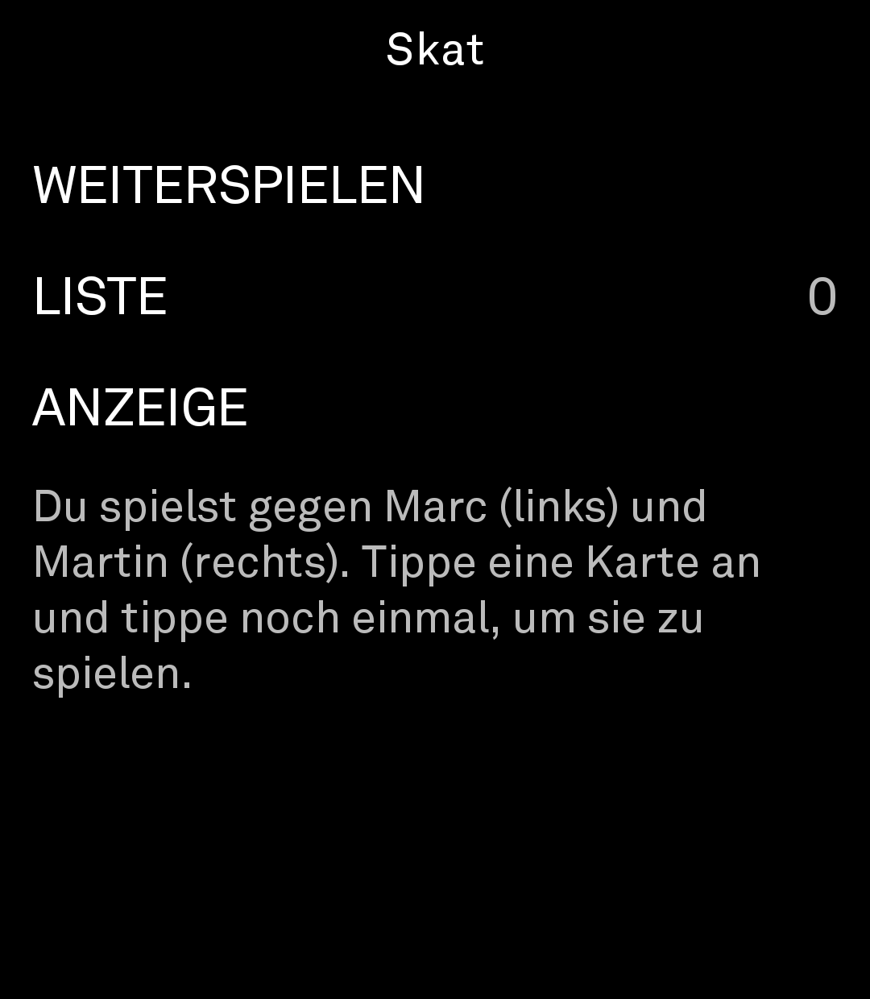
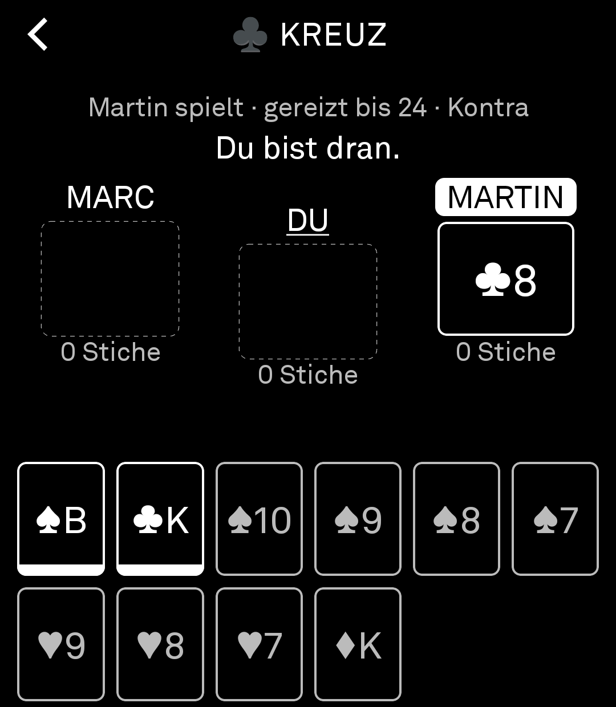
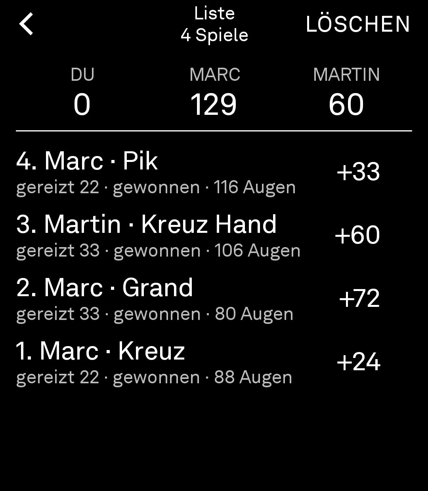

# FOX Skat Light
Skat auf dem Light Phone III – offline gegen zwei Computergegner.

<p>
  
  
  
</p>

## Was es kann

- **Ein Spieler gegen zwei Computergegner** (Marc links, Martin rechts; die Namen lassen sich
  unter `ANZEIGE` ändern), nach den Regeln der
  Internationalen Skatordnung. Geber, Vorhand, Mittelhand und Hinterhand wechseln jede Runde.
- **Reizen:** Mittelhand sagt, Vorhand hört, danach Hinterhand. Unten tippst du `PASSE`, `JA` oder den
  nächsten Reizwert. Haben beide anderen gepasst, kannst du als Vorhand für 18 spielen.
- **Ramsch**, wenn alle passen: Buben sind Trumpf, jeder spielt für sich, der Skat geht an den
  letzten Stich. Wer die meisten Augen hat, verliert sie. Jede Jungfrau (kein Stich) verdoppelt,
  ein Durchmarsch (alle Stiche) bringt +120.
- **Skat:** aufnehmen und zwei Karten drücken, oder Hand spielen.
- **Spiele:** Kreuz, Pik, Herz, Karo, Grand, Null und Null Ouvert. Bei Handspielen kannst du
  Schneider, Schwarz oder Ouvert ansagen. Beim Ansagen steht neben jedem Spiel sein Wert.
- **Ausspielen:** Karte antippen (sie wird hervorgehoben), noch einmal tippen spielt sie.
  Karten, die du nicht bedienen darfst, sind abgeblendet. Der letzte Stich bleibt stehen, bis
  der nächste beginnt.
- **Kontra und Re:** Vor der ersten Karte fragt das Spiel jeden Gegenspieler, der beim Reizen
  mindestens 18 gesagt oder gehalten hat, ob er Kontra gibt (unten `WEITER` oder `KONTRA`).
  Nach einem Kontra kann der Alleinspieler `RE` sagen. Kontra verdoppelt das Ergebnis, Re
  vervierfacht es; in der Liste steht es beim Spiel dabei. Im Ramsch gibt es kein Kontra.
- **Abrechnung:** Spitzen (mit/ohne), Hand, Schneider, Schwarz, Ansagen, Ouvert und Überreizen.
  Gewonnen zählt der Spielwert, verloren das Doppelte als Minus.
- **Tisch:** Oben steht, was gerade los ist. Darunter sitzt ihr wie am echten Tisch: links Marc,
  in der Mitte und etwas tiefer du, rechts Martin. Beim Reizen steht dort, was jeder zuletzt gesagt hat, beim Spielen
  die Karte, die er in den Stich gelegt hat. Der Alleinspieler ist schwarz hinterlegt, wer dran ist,
  unterstrichen. Trümpfe auf deiner Hand haben unten einen schwarzen Balken.
- **Liste** mit allen Spielen und dem Zwischenstand oben. Sie bleibt gespeichert.
- **Laufende Runde:** Sie wird nach jedem Zug gespeichert. Kommt ein Anruf dazwischen oder ist
  der Akku leer, geht es beim nächsten Öffnen mit `WEITERSPIELEN` genau dort weiter.
- Unter `ANZEIGE`: Hell/Dunkel, die Namen der beiden Computergegner und ihre `ERFAHRUNG`.

Noch nicht dabei: Schieben im Ramsch, Bockrunden, Seeger-Fabian-Wertung.

## Die Computergegner

Sie reizen nach Faustregeln (Trümpfe, Buben, Asse, Zehnen mit Ass) und drücken blanke Zehnen und
kurze Farben. Beim Ausspielen rechnen sie voraus: Sie merken sich alle gefallenen Karten und wer
welche Farbe nicht bedienen konnte, verteilen die Karten, die sie nicht sehen, 50-mal passend dazu
neu, spielen jede Verteilung bis zum Ende durch und nehmen die Karte, die im Schnitt am besten
abschneidet. Sie sehen dabei nur, was ein Mensch am Tisch auch sehen würde.

Gegen die Computergegner aus Version 0.3 holt ein neuer Computergegner bei denselben Karten
rund 8 Punkte je Spiel mehr (`StrengthTest`).

**Sie lernen dazu:** Nach jedem Spiel passen sie an, wie mutig sie reizen und wie schnell sie
Kontra geben. Gewinnen sie als Alleinspieler, werden sie etwas mutiger, verlieren sie, deutlich
vorsichtiger. Ein Kontra, das trotzdem verloren geht, macht sie vorsichtiger mit Kontra; verlierst
du ein Spiel, ohne dass sie Kontra gegeben haben, geben sie künftig eher Kontra. Das Gelernte bleibt
auf dem Telefon gespeichert; unter `ANZEIGE` → `ERFAHRUNG` steht, aus wie vielen Spielen sie schon
gelernt haben, und zweimal Tippen lässt sie von vorn anfangen.

## Datenschutz

| Was | Wohin | Wozu |
|---|---|---|
| nichts | – | – |

- Das Tool braucht keine Berechtigungen und baut keine Verbindung ins Internet auf.
- Die Liste, die laufende Runde und das Gelernte der Computergegner liegen im privaten Speicher
  des Tools auf dem Telefon.

## APK bauen lassen

Bei jedem Push auf `main` baut **Actions → „APK bauen“** die App, führt die Tests aus und legt
unter **Releases** die Datei `FOX-Skat-Light.apk` ab. Für Pull Requests erscheint sie dort als
Test-Version „test-pr-…“ und wird bei jedem neuen Push auf den PR ersetzt. Ist der PR gemergt oder geschlossen,
räumt **„Test-Versionen aufräumen“** sie wieder weg, damit Stores wie der BrightMarket nur echte
Releases sehen.

Lokal geht es auch mit Android Studio oder:

```
./gradlew :tool:assembleDebug -DlightSdk.toolOnly=true
```

## Aufs Light Phone bringen

**Variante A – Tool Manager über WLAN (ohne Kabel)**

1. Im [Light-Dashboard](https://dashboard.thelightphone.com) den Entwicklermodus einschalten.
2. Telefon und Computer ins selbe WLAN, auf dem Telefon in den Einstellungen den Tool Manager
   starten und die angezeigte Adresse im Browser am Computer öffnen.
3. Unter `Developer` → `Developer Keys` die Datei
   [`docs/sideloading/light_debug_signing_key.txt`](docs/sideloading/light_debug_signing_key.txt)
   hochladen (falls noch nicht geschehen).
4. Unter `Upload Tools` die `FOX-Skat-Light.apk` hochladen. Danach erscheint „Skat“ in der Toolbox.

**Variante B – per Kabel mit adb:** `adb install FOX-Skat-Light.apk`

## Aufbau

Der Code liegt in [`tool/src/main/kotlin/io/github/foxskat`](tool/src/main/kotlin/io/github/foxskat):

| Datei | Inhalt |
|---|---|
| `core/Cards.kt` | Farben, Werte, Karten, Augen |
| `core/Rules.kt` | Spielarten, Trumpf, Bedienen, Stiche, Spitzen, Spielwert und Abrechnung |
| `core/Round.kt` | eine Runde vom Reizen bis zur Abrechnung, prüft jeden Zug, speichert und lädt sie |
| `core/Ai.kt` | Computergegner: Reizen, Drücken, Ansagen, Kontra, Ausspielen |
| `core/Lookahead.kt` | Vorausrechnen beim Ausspielen über erratene Kartenverteilungen |
| `core/Experience.kt` | was die Computergegner aus den Spielen lernen |
| `core/ScoreSheet.kt` | Liste und Sortierung der Hand |
| `core/Texts.kt` | Texte für die Anzeige |
| `ui/…Screen.kt` | Oberfläche mit den Bausteinen der Light SDK |

`core/` kommt ohne Android aus; die Tests dazu liegen in `tool/src/test`.

Die Bildschirmfotos liegen in [`docs/screenshots`](docs/screenshots). Bright Market zeigt sie von dort
automatisch an, sortiert nach Dateinamen (`1-…`, `2-…`, `3-…`).

Der Rest des Repos ist die [Light SDK](https://github.com/lightphone/light-sdk) (Stand Oktober 2026),
deren ursprüngliche README in `README.light-sdk.md` liegt.

## Für die offizielle Tool-Bibliothek

Das Tool arbeitet komplett lokal, ohne Konto, ohne Tracking und ohne Werbung, und hat ein klares
Ende (eine Runde). Damit passt es zu den [Tool Guidelines](TOOL_GUIDELINES.md).
